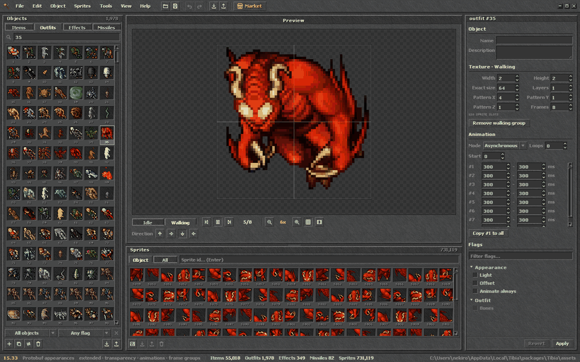

<div align="center">


# OTS Creator

**Object and map editor for Open Tibia clients, from `Tibia.dat` / `Tibia.spr` to Tibia 12+ assets.**

[](https://github.com/nekiro/ots-creator/releases/latest)
[](https://github.com/nekiro/ots-creator/releases)

[](LICENSE)

[Download](https://github.com/nekiro/ots-creator/releases/latest) ·
[Features](#features) ·
[Map editor](#map-editor) ·
[OTOBJ format](#otobj-object-format) ·
[Development](#development)

</div>

It looks and feels like the Tibia client and has a built-in market to share objects and
sprites. Built with [Wails v3](https://v3.wails.io) (Go) and Svelte 5.



## Install

Download the latest build from [Releases](https://github.com/nekiro/ots-creator/releases).
Later versions install from the built-in updater.

- **Windows:** `otscreator-amd64-installer.exe`, or the portable `otscreator-windows-amd64.exe`.
- **macOS 12+:** `otscreator-darwin-arm64.zip` (Apple Silicon) or `otscreator-darwin-amd64.zip`
  (Intel). Move `otscreator.app` to Applications. The app is not notarized, so the first
  start is blocked: click "Open Anyway" in System Settings > Privacy & Security, or run
  `xattr -dr com.apple.quarantine /Applications/otscreator.app`.

## Features

### Clients

- **Every `Tibia.dat` / `Tibia.spr` version**, detected from the file signatures, with OTFI
  files, extended sprites, transparency, improved animations and frame groups.
- **Tibia 12+ assets:** `catalog-content.json`, protobuf `appearances.dat` and LZMA sprite
  sheets, with object names and descriptions. Unchanged files are written back byte for byte.
- **New clients and conversion** between versions and between dat/spr and assets
  ("Compile as"), with a warning for every flag the target cannot store.
- **Optional `items.otb` sync** for servers that map server ids to client ids with it (TFS,
  OTServ). Pick the file in Open client or in File > Server items; it is remembered per
  client. Compiling also updates it: server items follow moved client items, edited items
  get their client data reloaded (flags, light, minimap color, sprite hash…) and new client
  items get new server ids. Server ids and server-only data are kept, and an unchanged file
  is not rewritten.

### Object editing

- **Object list** with items, outfits, effects and missiles, search by id or name, and flag
  filters.
- **Live preview** of animations, directions, idle and walking groups, addons, mounts and
  outfit colors, with zoom and a pixel grid.
- **Properties** for layout, patterns, frame durations and every flag.
- **Sprites** per object or for the whole client: multi-select, replace, import, export, and
  drawing with a pixel grid, zoom and pan.
- Undo/redo, copy and paste of whole objects or only their properties, bulk edit,
  duplicate and remove.

### Import and export

- **Objects** as `.otobj` (the native format, see [below](#otobj-object-format)) or OBD from
  ObjectBuilder (import of versions 1 to 3, export as version 3). The export format is a
  setting. The object viewer opens both without a client.
- **Export everything** at once: all objects (one folder per category) or all sprites
  (single files or sheets).
- **Sprite sheets** of one frame group or a whole outfit. On import the layout (directions,
  mask layer, mounts, addons, frames) is detected from the image.
- **Drop** images, `.otobj` or `.obd` files anywhere, onto the preview or onto an object, or
  paste a PNG with Ctrl+V. A slicer cuts images into sprites.

### Compare and merge clients

- **Side by side** by category. Sprites are compared by pixels, not ids, and differences
  that only come from the client formats are ignored.
- **Every difference** shows both versions, animated on hover, and what changed (flags,
  size, patterns, frames, animation, sprites). An empty placeholder against a real object
  counts as new; a filter hides ids that are empty in the only client that has them.
- **Copy in both directions**, keeping ids or appending, or merge all of B into A. Objects
  of B can be queued (double click) and dropped into slots of A one by one, or all at once
  into free ids. Sprites with the same pixels under the same id are reused.
- Every copy is one undo step, copies that kept their ids can be reverted one by one, and
  the second client can be compiled from the same window.

### Tools

- Optimize sprites (duplicate, empty and unused ones), set frame durations in bulk, and
  split or merge outfit frame groups.
- Reorder objects: drag them to other ids, or cut and click a slot. They swap places, or
  are inserted and the objects between shift. Item ids stored in items (market, NPC
  currency) follow the moved items.

### Market

- Browse objects and sprite packs from other users: categories, tags, search, live preview
  and one-click import.
- Publish an object, sprites or an `.otobj` / `.obd` / image file. No account: pick a
  nickname, Tibia-style tags and a license, and delete your own entries later.

### Performance

- Heavy work (comparing, searching, optimizing, decoding Tibia 12+ sheets, exporting) uses
  every CPU core, so clients with hundreds of thousands of sprites stay fast.
- Long operations run in the background with progress in the status bar, and you can keep
  editing during an export. The export window can be hidden and reopened. **Stop** asks
  first and keeps the files written so far.
- Closing the app asks first while an export runs or when changes are not applied or
  compiled yet.

## Map editor

Switch between **Objects** and **Map** at the top left. Maps are drawn with the sprites of
the open client; object changes show after **Reload from client**.

- **Files:** OTBM versions 1 to 4 open and are saved as version 2 (what servers load), with
  houses, spawns (one file, or separate monster and NPC files), zones, towns and
  waypoints. Several maps open in tabs.
- **Item ids:** server ids (translated with `items.otb`) or client ids, detected
  automatically. Names and types come from `items.xml`.
- **Brushes:** grounds with automatic borders, walls with doors and windows, doodads,
  carpets, tables, houses, creatures and spawns, waypoints, zones, PZ / no-PvP / no-logout
  flags and an eraser. Size, square or circle shape, Shift+drag fills a rectangle, and any
  item can be placed as is.
- **Brush files** use the editor's own JSON format and are edited in the app. Brushes,
  tilesets and creatures of Remere's Map Editor are imported from its data folder, and a
  selection becomes a doodad brush.
- **Layout:** a **Library** of everything to draw with (terrain, decoration, items,
  creatures, one search), a **World** outline of towns, houses, waypoints and areas, and an
  inspector for whatever you click (tile, house, town, or the map and its statistics).
  Changes apply as you type.
- **Ctrl+K** goes to anything: a position (pasted in any format), a town, house, waypoint,
  brush, item, creature or command.
- **Selection** over one or several floors, with a floating bar (copy, move between floors,
  redo borders, find, make a brush) and an undo history you can jump back in.
- **Find and tools:** a find panel with replace and remove; map tools (unknown items,
  corpses, empty spawns, unseen tiles, borders) on the selection or the whole map; import
  of another map at an offset; minimap export.
- **Big maps:** the backend builds the drawing data of each 32×32 chunk once and the GPU
  keeps it (WebGL2), so panning and zooming only move the camera and only animated sprites
  update per frame. Plain tiles are stored packed, so maps with millions of tiles stay
  small in memory.

### Server item attributes

Some servers add their own item attributes to OTBM (for example quest numbers on chests
and doors). The editor cannot skip an attribute it does not know, because OTBM does not
store attribute sizes: it warns and drops that attribute and the ones after it on the item.

To keep them, put `<map>-attributes.json` next to the map (`world-attributes.json` for
`world.otbm`) and list each attribute with its code and type:

```json
[
  { "code": 25, "name": "Door quest number", "type": "u16" },
  { "code": 26, "name": "Door quest value", "type": "i32" },
  { "code": 28, "name": "Chest quest number", "type": "u16" }
]
```

Types: `u8`, `u16`, `u32`, `i32`, `u64` (little-endian, as the server writes them) and
`string` (uint16 length, then the text). The file is read when the map opens; listed
attributes are kept unchanged and written back when the map is saved. Codes of standard
OTBM attributes (1 to 24 and 128) cannot be redefined. `name` is for you; the editor does
not use it yet.

## OTOBJ object format

`.otobj` is a ZIP with a `manifest.json` and one PNG sprite sheet per frame group. Full
specification: [docs/otobj.md](docs/otobj.md).

```
manifest.json        category, name, flags by name, frame groups, animation, NPC trade
sprites/idle.png     sprite sheet in the ObjectBuilder layout
sprites/walking.png
```

Why not OBD:

- **Readable:** plain JSON you can read in a text editor and diff in git. OBD is one
  LZMA-compressed binary block.
- **Version independent:** flags are stored by name (`pickupable`, `hasLight`), not as the
  flag bytes of one dat version. On import the client keeps what it can store and warns
  about the rest.
- **Editable sprites:** normal PNG sheets in the ObjectBuilder layout.
- **Complete:** also stores names, descriptions, NPC trade, Tibia 12+ flags and 64 px sprites.
- **Extensible:** readers ignore unknown keys and files, so new fields need no new version.

Measured on the current CipSoft client (one file at a time, one core):

| | OBD | OTOBJ |
|---|---|---|
| Reading | 1x | 2 to 4x faster |
| Writing 1 000 items | 3.6 s | 0.26 s |
| Typical outfit (citizen) | 84 KB | 80 KB |
| Outfit with many colors | 134 KB | 386 KB |
| All 1 978 outfits | 72 MB | 111 MB |

Files can be up to 3 times larger, because LZMA compresses raw pixels better than PNG.
Sheets with at most 256 colors use a palette, which brings most outfits to the size of OBD.
OBD stays fully supported for ObjectBuilder, and the market keeps storing objects as OBD.

## Development

Requirements: Go 1.26+, Node 22+, `wails3` CLI (`go install github.com/wailsapp/wails/v3/cmd/wails3@latest`).

```sh
wails3 task dev        # run with hot reload
wails3 task build      # production build into bin/
wails3 task test       # Go + frontend unit tests
```

## License

Apache License 2.0 with the Commons Clause (see `LICENSE` and `NOTICE`): you may use,
modify and share OTS Creator, but you may not sell it. Derived works must keep the
copyright notices and credits.

Copyright (c) 2026 Marcin Jałocha (nekiro)
