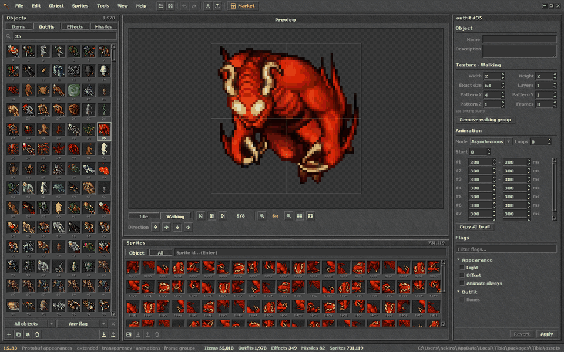

<div align="center">


# OTS Creator

**Object and map editor for Open Tibia clients, from `Tibia.dat` / `Tibia.spr` to Tibia 12+ assets.**

[](https://github.com/nekiro/ots-creator/releases/latest)
[](https://github.com/nekiro/ots-creator/releases)

[](LICENSE)

[Download](https://github.com/nekiro/ots-creator/releases/latest) ·
[Features](#features) ·
[Map editor](#map-editor) ·
[Server items](#server-items) ·
[AI agents](#ai-agents-mcp) ·
[Formats](#file-formats) ·
[Development](#development)

</div>

It looks and feels like the Tibia client and has a built-in market to share objects and
sprites. Built with [Wails v3](https://v3.wails.io) (Go) and Svelte 5.



## Install

Download the latest build from [Releases](https://github.com/nekiro/ots-creator/releases).
Later versions install from the built-in updater.

- **Windows:** `otscreator-amd64-installer.exe`, or the portable `otscreator-windows-amd64.exe`.
- **macOS 12+:** `otscreator-darwin-arm64.zip` (Apple Silicon) or `otscreator-darwin-amd64.zip`
  (Intel). Move `otscreator.app` to Applications. The app is not notarized, so the first
  start is blocked: click "Open Anyway" in System Settings > Privacy & Security, or run
  `xattr -dr com.apple.quarantine /Applications/otscreator.app`.
- **Linux** (x86_64 and arm64, GTK 4 and WebKitGTK 6.0: Ubuntu 24.04+, Debian 13+, Fedora
  40+): `otscreator-linux-amd64.AppImage` / `otscreator-linux-arm64.AppImage`, made
  executable with `chmod +x`. The built-in updater replaces the AppImage file. The `.deb`
  and `.rpm` packages install the app system-wide instead; update them by installing the
  package of the next version.

## Features

### Clients

- **Every `Tibia.dat` / `Tibia.spr` version**, detected from the file signatures, with OTFI
  files, extended sprites, transparency, improved animations and frame groups.
- **Tibia 12+ assets:** `catalog-content.json`, protobuf `appearances.dat` and LZMA sprite
  sheets, with object names and descriptions. Unchanged files are written back byte for byte.
- **New clients and conversion** between versions and between dat/spr and assets
  ("Compile as"), with a warning for every flag the target cannot store.
- **Server files:** an optional `items.otb` is kept in sync when compiling, and an
  optional `items.xml` is shown and edited per item. See [Server items](#server-items).

### Object editing

- **Object list** with items, outfits, effects and missiles, search by id or name, and flag
  filters.
- **Live preview** of animations, directions, idle and walking groups, addons, mounts and
  outfit colors, with zoom and a pixel grid.
- **Properties** for layout, patterns, frame durations and every flag.
- **Sprites** per object or for the whole client: multi-select, replace, import, export, and
  drawing with a pixel grid, zoom and pan.
- Undo/redo, copy and paste of whole objects or only their properties, bulk edit,
  duplicate and remove.

### Import and export

- **Objects** as `.otobj` (the native format, see [OTOBJ](docs/otobj.md)) or OBD from
  ObjectBuilder (import of versions 1 to 3, export as version 3). The export format is a
  setting. The object viewer opens both without a client.
- **Export everything** at once: all objects (one folder per category) or all sprites
  (single files or sheets).
- **Sprite sheets** of one frame group or a whole outfit. On import the layout (directions,
  mask layer, mounts, addons, frames) is detected from the image.
- **Drop** images, `.otobj` or `.obd` files anywhere, onto the preview or onto an object, or
  paste a PNG with Ctrl+V. A slicer cuts images into sprites.

### Compare and merge clients

- **Side by side** by category. Sprites are compared by pixels, not ids, and differences
  that only come from the client formats are ignored.
- **Every difference** shows both versions, animated on hover, and what changed (flags,
  size, patterns, frames, animation, sprites). An empty placeholder against a real object
  counts as new; a filter hides ids that are empty in the only client that has them.
- **Copy in both directions**, keeping ids or appending, or merge all of B into A. Objects
  of B can be queued (double click) and dropped into slots of A one by one, or all at once
  into free ids. Sprites with the same pixels under the same id are reused.
- Every copy is one undo step, copies that kept their ids can be reverted one by one, and
  the second client can be compiled from the same window.

### Tools

- Optimize sprites (duplicate, empty and unused ones), set frame durations in bulk, and
  split or merge outfit frame groups.
- Reorder objects: drag them to other ids, or cut and click a slot. They swap places, or
  are inserted and the objects between shift. Item ids stored in items (market, NPC
  currency) follow the moved items.

### Market

- Browse objects and sprite packs from other users: categories, tags, search, live preview
  and one-click import.
- Publish an object, sprites or an `.otobj` / `.obd` / image file. No account: pick a
  nickname, Tibia-style tags and a license, and delete your own entries later.

### Performance

- Heavy work (comparing, searching, optimizing, decoding Tibia 12+ sheets, exporting) uses
  every CPU core, so clients with hundreds of thousands of sprites stay fast.
- Long operations run in the background with progress in the status bar, and you can keep
  editing during an export. The export window can be hidden and reopened. **Stop** asks
  first and keeps the files written so far.
- Closing the app asks first while an export runs or when changes are not applied or
  compiled yet.

## Map editor

Switch between **Objects** and **Map** at the top left. Maps are drawn with the sprites of
the open client. Full guide: [docs/map-editor.md](docs/map-editor.md).

- **Files:** OTBM versions 1 to 4, and the text format [OTMAP](docs/otmap.md) that git can
  diff and merge, with houses, spawns, zones, towns and waypoints. Several maps open in tabs.
- **Brushes:** grounds with automatic borders, walls with doors and windows, doodads,
  carpets, tables, houses, creatures, spawns, zones and tile flags. Brushes, tilesets and
  creatures of Remere's Map Editor are imported.
- **Navigation:** a library of everything to draw with, a world outline, an inspector for
  whatever you click, and **Ctrl+K** to go to any position, town, house, brush or item.
- **Selection and tools:** copy and move between floors, find and replace, map checks,
  import of another map, minimap export.
- **Big maps:** drawn by the GPU, so maps with millions of tiles stay fast.
- **Map together:** several people edit one map live, hosted by one of them. See
  [docs/map-together.md](docs/map-together.md).

## Server items

For the files a server keeps next to the client. Both are optional and remembered per
client. Full guide: [docs/server-items.md](docs/server-items.md).

- **`items.otb`** (servers on server ids): compiling keeps it in sync with the client.
- **`items.xml`:** each item shows and edits its entry (name, attributes); compiling writes
  the edits and an entry for every new item, and keeps the rest of the file byte for byte.
- **Attribute map** (servers on client ids): writes the properties of the client items to
  `items.xml` as attributes, and shows where an entry differs from the client.

## AI agents (MCP)

AI agents such as Claude Code can build maps and edit objects through an
[MCP](https://modelcontextprotocol.io) server, with the editor open or closed. Setup and
tools: [docs/mcp.md](docs/mcp.md).

## File formats

- **[OTOBJ](docs/otobj.md):** one object as a ZIP with a readable `manifest.json` and PNG
  sprite sheets. Flags are stored by name, so a file does not depend on a client version.
  OBD from ObjectBuilder stays supported.
- **[OTMAP](docs/otmap.md):** a map as text, one line per tile in one file per 32×32
  sector. An edited tile is one changed line, and edits to different tiles merge in git.
  Converting from and to OTBM loses nothing.

## Development

Requirements: Go 1.26+, Node 22+, `wails3` CLI (`go install github.com/wailsapp/wails/v3/cmd/wails3@latest`).
On Linux also a C compiler and the GTK 4 / WebKitGTK 6.0 headers (Debian/Ubuntu:
`sudo apt install build-essential pkg-config libgtk-4-dev libwebkitgtk-6.0-dev`).

```sh
wails3 task dev        # run with hot reload
wails3 task build      # production build into bin/
wails3 task test       # Go + frontend unit tests
```

## License

Apache License 2.0 with the Commons Clause (see `LICENSE` and `NOTICE`): you may use,
modify and share OTS Creator, but you may not sell it. Derived works must keep the
copyright notices and credits.

Copyright (c) 2026 Marcin Jałocha (nekiro)
